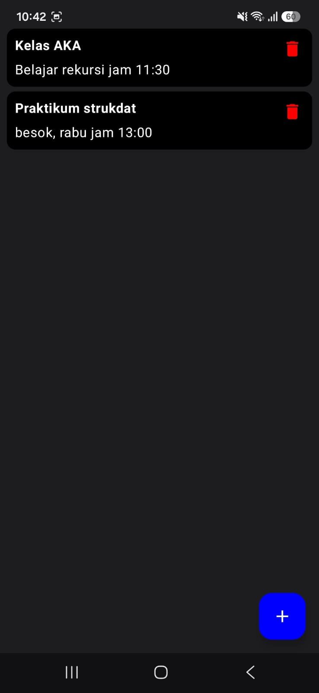
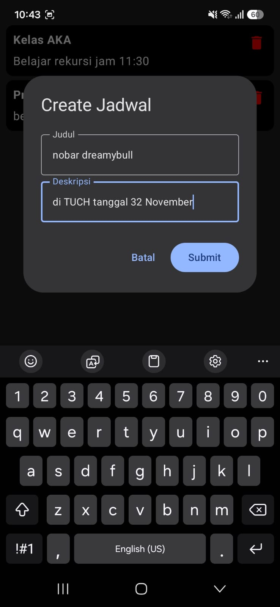
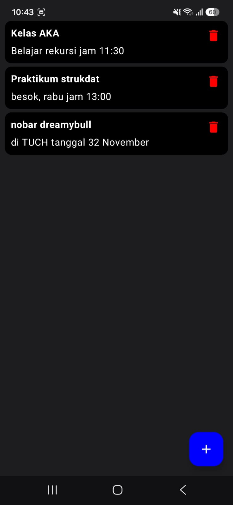

# Tentang Saya
**Nama:** Muhammad Fakhry Ardiansyah\
**NIM:** 103022500030\
**Jurusan:** S1 Rekayasa Perangkat Lunak

# Ambatuplan
## Previews
| Tampilan Kosong | Dengan Data | Tambah Jadwal | Hasil Akhir |
| :---: | :---: | :---: | :---: |
|  |  |  |  |

# How to Run (Cara 1)
1. Git clone repo ini
2. Buka Android Studio di root nya
3. Tunggu build gradle selesai
4. Klik tombol Run di atas

# How to Run (Cara 2)
1. Download apk nya di tag release v1.0.0
2. Ikutin arahan install apk ga dikenal, tergantung HP, hanya work di Android
3. Buka aplikasinya

# How to Use (Tambah Jadwal)
1. Buka aplikasinya (Lihat **How to Run**)
2. Tekan tombol **+** biru di kanan bawah
3. Isi **Judul** (Wajib) dan **Deskripsi** (Optional)
4. Klik submit
5. Jadwal langsung tampil di katalog

# How to Use (Hapus Jadwal)
1. Tekan icon tempat sampah di ujung kanan card jadwal
2. Jadwal langsung hilang dari katalog

# Deklarasi Penggunaan AI
- Apakah menggunakan AI? **Ya**
- Tool AI yang digunakan: **Gemini**, **Abang India 😂**
- Estimasi persentase kontribusi AI: **12%**
- Bagian kode/fitur yang dibantu AI: **Belajar Sintaks**, **Debugging MutableState**
- Pernyataan: **Saya menyatakan bahwa saya memahami alur dan fungsi dari seluruh kode yang ada dalam repositori ini**
